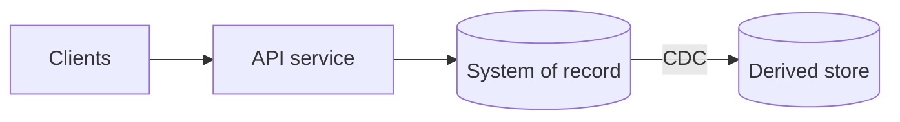

# Architecture plan: ⟨system name⟩

> **Status**: Draft | Approved ⟨date⟩ · **Depth**: Lite | Standard | Deep · **Owner**: ⟨name⟩
>
> Lite plans need sections 1, 2, 5, 6, 9, 11, and 14 (put backups in section 5). Delete sections that don't apply rather than leaving them empty. Mark every estimate that hasn't been confirmed with `ASSUMPTION`.

## 1. Context and goals

What is being built, for whom, and why now. What is explicitly out of scope.

## 2. Requirements

### Key operations

| Operation | Read/write | Access pattern (key, range, search, aggregate, traversal) | Frequency | Importance |
|---|---|---|---|---|

### Load parameters

| Parameter | Now | 12 months | 36 months | Source or `ASSUMPTION` |
|---|---|---|---|---|

### Performance targets

| Operation | p50 | p99 | Measured at | Notes |
|---|---|---|---|---|

### Correctness invariants (must never happen)

- ⟨e.g. a seat is sold to two customers⟩

### Durability and availability

RPO, RTO, failure scope the system must survive (process, machine, zone, region), offline clients.

### Evolution, compliance, and constraints

Independent deployers, slow-updating clients, regulatory requirements, team and budget constraints.

## 3. Capacity estimate

The arithmetic behind the load parameters and storage size, step by step, with assumptions marked.

## 4. Architecture overview

One paragraph explaining the diagram.

## 5. Data stores

| Store | Role (system of record, or derived from what and how) | Data held | Model | Why this store | Freshness | Backups |
|---|---|---|---|---|---|---|

## 6. Data model

Entities and relationships; the top queries mapped to indexes; normalization and denormalization decisions and how any copies are maintained.

## 7. Dataflow

The write path and read path for each key operation. For every derived store: the feeding mechanism (CDC, outbox, batch), ordering key, maximum staleness, and how it is rebuilt from scratch.

## 8. Decisions (ADRs)

### ADR-1: ⟨title⟩

- **Context**: the requirement or constraint that forces a choice
- **Options considered**: two or three, with how each fares
- **Decision**: what was chosen
- **Trade-offs accepted**: what is given up
- **Revisit when**: the observable signal that would reopen this decision

## 9. Guarantees per operation

| Operation | Isolation / consistency | Read-your-writes | Ordering | Idempotency mechanism | Behavior during a network partition |
|---|---|---|---|---|---|

## 10. Failure modes

| Failure | Detection | Impact | Mitigation | Tested by |
|---|---|---|---|---|

## 11. Schema evolution and migrations

Encoding formats and compatibility modes per interface; the procedure for breaking changes (expand and contract); rollback plan.

## 12. Observability

Service-level indicators and objectives; dashboards; alerts on latency percentiles, error rates, replication lag, consumer lag, and queue depth; reconciliation jobs between the system of record and derived stores.

## 13. Security and data protection

Personal data held and why; retention; the deletion path (including logs, backups, derived stores, analytics); access control and auditing.

## 14. Implementation plan

| Slice | Scope | Risk retired | Done when |
|---|---|---|---|
| 0 | Spike: ⟨riskiest assumption⟩ | ⟨what it proves⟩ | ⟨measurable result⟩ |

Thin vertical slices, riskiest first. Observability ships with the first slice.

## 15. Risks and open questions

| Item | Owner | Resolve by |
|---|---|---|

## 16. Approval

Approved by ⟨name⟩ on ⟨date⟩. Changes after approval are recorded as new or amended ADRs.
